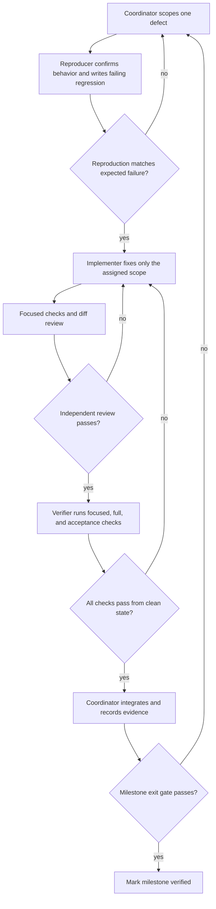

# Milestones 0–1: Agent Execution Plan

This is the execution companion to [NEW_PLAN.md](./NEW_PLAN.md). It covers the baseline repair and fresh verification (Milestone 0), then production-level closure of the trust layer (Milestone 1). It is a workflow for a small agent team: agents must return evidence and bounded diffs, not broad claims of completion.

## Operating model

Use one coordinator and at most three worker agents at a time. Give each worker a named work package, file ownership, expected result, and verification command. Since the agents share a workspace, workers must not edit the same files concurrently. For parallel implementation, use isolated worktrees; otherwise run work packages serially. The coordinator is the only role that integrates changes and updates milestone status.

### Roles

| Role | Responsibility | Must return |
|---|---|---|
| Coordinator / integrator | Maintains the issue list and evidence ledger, assigns owners, resolves conflicts, integrates reviewed changes, and decides gate status. Does not accept a “done” report without command output or a source-level reason why a check cannot run. | Scope, merged diff, gate-by-gate status, remaining risks. |
| Reproducer / test author | Starts read-only. Reproduces a defect, states expected behavior and safety invariants, then adds the smallest regression test that fails for the defect. Does not implement the production fix. | Reproduction steps, failing test, expected result, and touched test files. |
| Implementer | Owns one defect or one cohesive package. Reads the failing test and relevant contracts, fixes the behavior with the smallest safe change, and runs focused checks. | Root cause, changed files, focused command output, compatibility impact. |
| Independent reviewer | Does not author the fix. Reviews the diff against requirements, contracts, security, state/concurrency behavior, failure paths, and test quality. Can request changes but cannot approve based only on a green test. | Specific findings by severity, or an explicit no-findings review. |
| Verifier | A separate agent from the implementer. Runs the acceptance checks from a clean temporary state, captures output, and checks the final diff and repository state. | Exact commands/results, gate evidence, and any environmental limitation. |

The coordinator can act as verifier after a worker slot is free, but should prefer a different worker for independent final verification. Do not have the implementer self-approve.

## The repeatable fix loop

### Loop rules

1. One loop ticket has one observable behavior and one implementation owner. Split unrelated failures rather than bundling them into a “trust cleanup.”
2. Write the expected behavior before the fix. Tests should assert externally meaningful outcomes as well as internals where appropriate: response, writes, version, audit, and emitted events.
3. Keep the change set reviewable. Do not reformat unrelated files, alter the M5 demo contract, or fold in later-milestone features.
4. Review findings must cite a file/line and a failure scenario. The implementer answers each finding in code or with a reasoned rebuttal; unresolved P0/P1 findings block verification.
5. Verifier uses a fresh temporary data directory and known test credentials. No test may depend on the developer's `.env`, persisted registry/audit files, a real Gemini key, or a pre-running service.
6. On a failed verification, return the exact failing command and output to the same implementation owner. Do not silently change acceptance criteria to make the gate green.
7. Allow two implementation/review cycles for one ticket. If it still fails, stop parallel edits; the coordinator rechecks the requirement and decomposes or redesigns the ticket before another cycle.
8. Always verify teardown: no child process, timer, SSE connection, temp directory, or fixed port is left behind after pass or failure.
9. Record every gate as `not started`, `in progress`, or `verified`, with a command and result. A file existing or an earlier README claim is not evidence.

## Milestone 0 work packages — trustworthy baseline

### M0.1 Repair the acceptance harness

**Owner:** one implementation agent. **Reviewer:** independent, read-only. **Verifier:** coordinator or another agent.

`npm run verify:p01` currently fails before starting the services: the second port allocation can receive the just-released ephemeral port repeatedly, and the script does not guarantee cleanup on every early failure.

Required behavior:

- Allocate distinct ports deterministically enough for CI and local runs. Prefer reserving both sockets until the child services bind, or scan a bounded candidate range while tracking attempted/selected ports; do not repeatedly close port 0 and assume the next allocation differs.
- Wrap spawned processes, temporary data, and mock stub servers in `try/finally` cleanup. Wait for shutdown and fail on premature child exit rather than polling until timeout.
- Make readiness checks report service name, URL, last response, and captured startup stderr on failure.
- Keep the script isolated from the user's configured ports and persistent data. Keep the scripted baseline path independent of Gemini credentials.
- Retain nonzero exit codes and a final summary even when an assertion fails; distinguish assertion failures from harness/setup errors.

**Review checklist:** port collision/reuse, process restart lifecycle, failure before first readiness, failure midway through checks, cleanup after assertion failure, temp directory removal, and Windows/macOS-compatible process handling if portability is a requirement.

### M0.2 Re-run Phase 0 and Phase 1 gates

Run in a clean checkout state and save the logs in the PR/task report, not as generated files in the repository.

1. `npm test`
2. `npm run verify:p01`
3. `npm run dev`, then check core `:8000/health`, mock `:5001/health`, and HTTP readiness for both Next.js clients (`:3000` and `:3001`).
4. Run the smoke flow from the UI: clean request, activate M5, baseline failure, healed success with four expected ops, and visible event/timeline update.
5. Stop the dev launcher and verify all four child services exit.

If the acceptance script finds product defects, open separate M1 loop tickets rather than weakening the harness. Update README and `PS01_BUILD_PLAN.md` status only after the evidence exists.

**Milestone 0 exit gate:** all commands and UI smoke pass from clean state; M5 ops are exactly `add_header`, `move_field`, `rename_field`, `coerce_type`; no process or test data leaks remain.

## Milestone 1 work packages — close trust and safety

Start by creating a gate ledger from `docs/HEALR_PHASE2_TO_FINAL_PLAN.md` §2 and §3.10. Some source behavior is already implemented; tests and end-to-end evidence are the primary gap. Reproduce before changing code.

### M1.1 Executor correctness and retry safety

**Scope:** `api-server/src/features/executor/`, focused executor tests, and only the necessary event contract updates.

- Three concurrent M5 calls with distinct IDs all return their own correct result, exactly one adapter commit occurs, and all callers receive consistent version/change metadata.
- The heal lock is released after success, structured halt, and thrown error; a later call can become leader.
- A missing credential halts with `credential_unavailable`; the resolved secret never appears in response, event, audit, or log.
- A non-lossless coercion and provenance failure return structured non-retryable halts, never HTTP 500.
- A 5xx read is retried once; a 5xx write is never retried. Assert upstream hit counts, not only returned status.
- Invalid logical arguments fail before any upstream request and are not sent into healing.
- Per-API round/time budgets and `enforce`/`log`/`off` settings are honored consistently.

**Acceptance:** focused deterministic tests, followed by the relevant M0 integration checks, all pass.

### M1.2 Draft, registry, rollback, and watchdog invariants

**Scope:** registry store and API route tests; one source owner for `registry/store.js` and related routes.

- A failed verification replay leaves the current version and adapter hash unchanged.
- Successful commit appends an immutable version with exact ops, tier, confidence, evidence, verification, and timing metadata needed by the UI.
- Re-register replaces an API atomically and resets its tool versions without damaging unrelated APIs.
- Rollback appends a new version with `rollbackOf`; it never rewrites prior history. After resetting the mock, the restored adapter passes without healing.
- A forced bad commit is detected by the watchdog, an automatic rollback version is appended, and the rollback event/audit entry agree.
- Config updates preserve unrelated fields and survive process restart.

**Acceptance:** assertions cover current version, full history, adapter hash, persisted snapshot after restart, events, and audit decisions.

### M1.3 Audit integrity, redaction, and tamper recovery

**Scope:** `api-server/src/features/audit/` and audit integration tests. Keep audit serialization/hash code under one owner.

- Commit, halt, proposed/log-only, manual rollback, and automatic rollback decisions have the expected records and indices.
- Edit and delete tampering identify the first broken index; a tail truncation is detected through the saved head anchor; restore returns verification to green.
- Credential values, authorization values, and secrets are absent from every persisted record; source references may remain.
- Empty logs, one-entry logs, malformed lines, and undefined optional properties have defined behavior rather than crashing the server.
- Audit export returns the same verified NDJSON records as the listing API.

**Acceptance:** unit tests for canonical hash behavior plus integration tests through `/audit`, `/audit/verify`, and dev tamper routes.

### M1.4 M9 and mock truth/no-write proof

**Scope:** demo mutation catalogue/server and its tests; keep mock source edits separate from executor/audit owners.

- Missing required credential and non-derivable `approval_code` variants both return a non-retryable safe halt.
- Mock write history stays empty for both rejection cases.
- First failure creates the expected audit/event state; repeated identical failure uses the intended negative cache without bypassing safety or hiding audit semantics.
- The mutation list/state endpoints expose metadata needed by the demo client instead of UI hardcoding.

**Acceptance:** assert response, write ledger, event, audit, and repeat-call timing/negative-cache behavior.

### M1.5 Contract and UI integration

**Scope:** contracts, API-client settings/tool-history/audit pages, and demo-client STOP/rollback feedback.

- Actual API and event shapes match `/contracts`; update schemas and examples in the same change as behavior changes.
- Settings changes are scoped to the selected API and round-trip through the server after refresh.
- A safe halt shows its structured reason; rollback displays the appended version; audit verify reflects exact broken index.
- The demo's healed event feed is correlated by `runId` and does not accidentally mark an early drift failure as final failure.
- Empty, offline, and loading paths remain usable; no UI control claims an action succeeded before server confirmation.

**Acceptance:** browser smoke at the supported desktop sizes plus keyboard traversal for the critical actions. Capture console/network errors and resolve them before sign-off.

## Milestone 1 evidence ledger

Use this as the coordinator's checklist; link each row to the failing regression and passing verification output.

| Gate | Required evidence | Status |
|---|---|---|
| M0 baseline harness and four-service startup | `npm test` passes 85/85; `npm run verify:p01` passes 17/17 with isolated ports/data and teardown; four local HTTP readiness checks returned 200; browser-level M5 UI comparison still needs verification | In progress |
| Re-registration schema cache correctness | Regression tests cover changed logical and response schemas; schema-fingerprinted AJV cache passes | Verified |
| Independent calls / one heal | Three-way concurrency test with distinct returned IDs and one commit | Verified in acceptance: all IDs returned; all callers report v2/four ops; exactly one heal commit |
| Credential and provenance safety | Missing-credential and rejected-bearer halts, non-lossless/provenance halts, cache-repair invalidation, no retry/write, no-secret-leak checks, and terminal event/audit lifecycle | Verified by focused tests and acceptance |
| Retry policy | Read/write 5xx hit-count test | Verified in acceptance: two read attempts, one write attempt |
| Draft isolation and rollback | Failed replay leaves version unchanged; manual rollback appends v3, preserves prior snapshots, persists after reload, and records matching event/audit | Manual rollback verified; failed replay covered by watchdog test |
| M9 safe halt | Missing Authorization and approval-code variants, no writes, repeat uses negative cache | Verified — both variants assert halt event/audit, no writes, <50 ms cached repeat; credential re-registration invalidates stale failure |
| Registry immutability | Caller-owned registration/commit inputs and `current`/`versions`/`version`/`diff`/compiled accessors cannot mutate history or invocation behavior | Verified — 8 isolated regression assertions pass |
| Audit integrity | Edit/delete/truncate detection, restore, secret redaction | In progress — redaction/edit+delete tamper, tail truncation/restore, route/export parity, malformed JSON/HEAD/record shapes, invalid anchor shape, append refusal, empty restore, and malformed/hash-invalid backup rejection tested; broader canonical-hash edge coverage remains |
| Watchdog / policy modes | Auto-rollback and enforce/log/off behavior | In progress — forced bad adapter rollback and enforce/log/off/disabled outcomes, versions, terminal events, and audits verified; config round-trip/reload verified |
| UI/API contracts | Settings round-trip, halt, rollback, verify, runId event correlation | In progress — settings merge/persistence and credential omission from GET/PATCH/event are tested; browser-level UI still open |
| Whole M1 gate | Full automated suite + clean-start integration suite, all previous rows verified | Not started |

## Execution update — 2026-10-16

- The acceptance harness repair and Phase 0/1 scripted acceptance passed. Its subprocess integration checks are green; the separate clean four-service browser/UI smoke remains open, so M0 is not yet marked verified.
- Four-service HTTP readiness was checked against the existing local processes on 2026-10-16: core `:8000`, mock `:5001`, API client `:3000`, and demo client `:3001` each returned HTTP 200. This is readiness evidence, not a browser-level walkthrough.
- The M1 audit identified the stale validator cache as a concrete correctness defect. The test-author/implementer loop reproduced it in both argument and response validators; schema fingerprinting fixes it, and the cache is bounded to 256 compiled validators. An independent reviewer found no blocking issue.
- Audit tail truncation and backup restore now have an isolated regression in addition to redaction/edit-tamper coverage. The focused audit test and full suite pass.
- The M9 test-author loop now passes for both independent variants: missing credentials halt before upstream; the approval-code failure reaches upstream once and the repeated call uses the negative cache; neither writes. Event/audit assertions for these cases remain open.
- A failure-sensitive watchdog regression now proves that `/dev/force-bad-commit` changes a marker-bearing request, the upstream rejects that version, rollback appends v3, and the parent adapter succeeds. Independent review found and the implementation now emits `call.succeeded` after that successful recovery; the test asserts event and audit records.
- Malformed JSONL/HEAD and invalid anchor shapes now produce explicit invalid verification results. Append refuses hash-invalid chains without writing; restore validates the backup and clears stale HEAD for an empty backup.
- Audit list/verify/export route tests now confirm export records match listing, delete tampering reports the broken index, and restore verifies green.
- After these additions, `npm test` passes 55/55 and `npm run verify:p01` passes 17/17. The acceptance concurrency gate now confirms exactly one commit and a shared v2 result for all three callers; read/write retry counts are asserted.
- The registry immutability probe found and fixed mutable ownership leaks through input objects, history snapshots, `diff()`, and compiled adapter handles. Registry writes and returned history are now detached; `current()` exposes a fresh compiled facade. Eight regression assertions pass.
- M9 now records a `halt` event and audit entry for both missing-credential and missing-approval cases, including cached repeats. The negative cache key includes API epoch, tool version, configuration, adapter/schema fingerprints, and hashes of configured and fallback credential environment values; a repaired credential registration is retried successfully. Repeat latency is asserted below 50 ms.
- Removing an API clears its negative-cache entries; the M9 regression deletes and re-registers the same API and confirms the first call reaches the upstream again. Credential fingerprints include refs used by credential-sourced request operations.
- Malformed and hash-invalid backups are rejected without changing the live audit log or HEAD. JSONL `null`, scalar, and incomplete-object rows now report `malformed_record`, preserve only the valid listing prefix, and do not throw from verify/list/append/restore.
- Policy-mode coverage verifies enforce commits, log proposes without applying, and off/disabled modes halt without diagnosis or replay while emitting halt events and audit records.
- Settings coverage verifies PATCH merge semantics, persistence across a registry reload, and that GET/PATCH/config.changed omit credential references while the core retains them.
- Initial provenance failures now produce an HTTP 200 structured `provenance_violation` halt, a halt event and audit record, and no upstream request or adapter history change. Policy-mode log and safety-gate exits also emit terminal `heal.finished` events.
- Latest full verification on 2026-10-16: `npm test` **85/85**, `npm run verify:p01` **17/17**, and `git diff --check` passed.
- M1 remains in progress. Rollback after a mock reset with the restored adapter replayed, broader canonical hash vectors, and UI/API browser acceptance still need focused evidence and independent review. M0 also remains in progress until the clean-start four-service UI smoke is completed.

- A rejected configured bearer returning 401 now has a focused regression: one upstream request, no write or version mutation, structured `credential_unavailable`, `call.failed`/`halt`/`heal.finished` correlation, a redacted audit record, and a cached repeat that does not call upstream again. The test passes.
- Failed concurrent follower replay and API deletion while a follower waits now use the shared domain-halt path. The deletion race regression asserts a structured `not_registered` result, correlated `call.failed`/`halt`/`heal.finished`, and one audit entry.
- Final gates for this iteration: `npm test` **85/85**, `npm run verify:p01` **17/17**, `git diff --check` passed. The M0 browser smoke and the remaining M1 evidence listed above are still open.

## Completion protocol

At the end of each milestone, the coordinator posts a short report with: changed work packages, exact verification commands and results, unresolved findings, environment limitations, and the updated evidence ledger. Mark M0 or M1 verified only when every required row is green. If any row is blocked by infrastructure, record the blocker and do not call the milestone complete.
